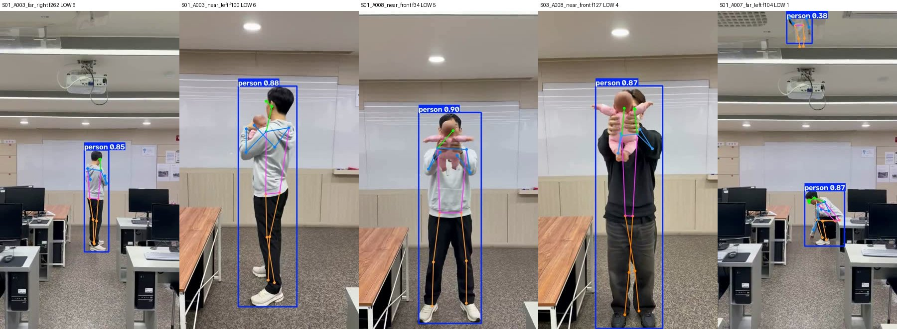
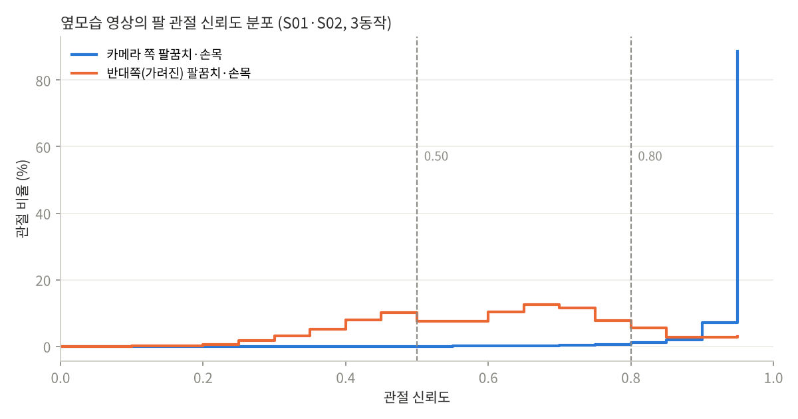
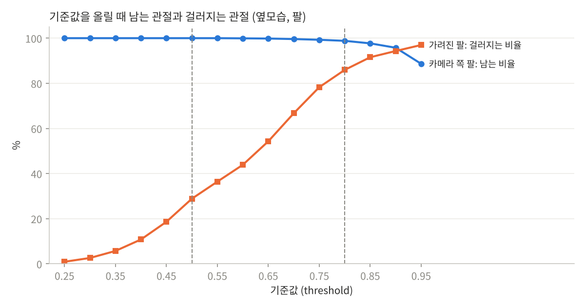
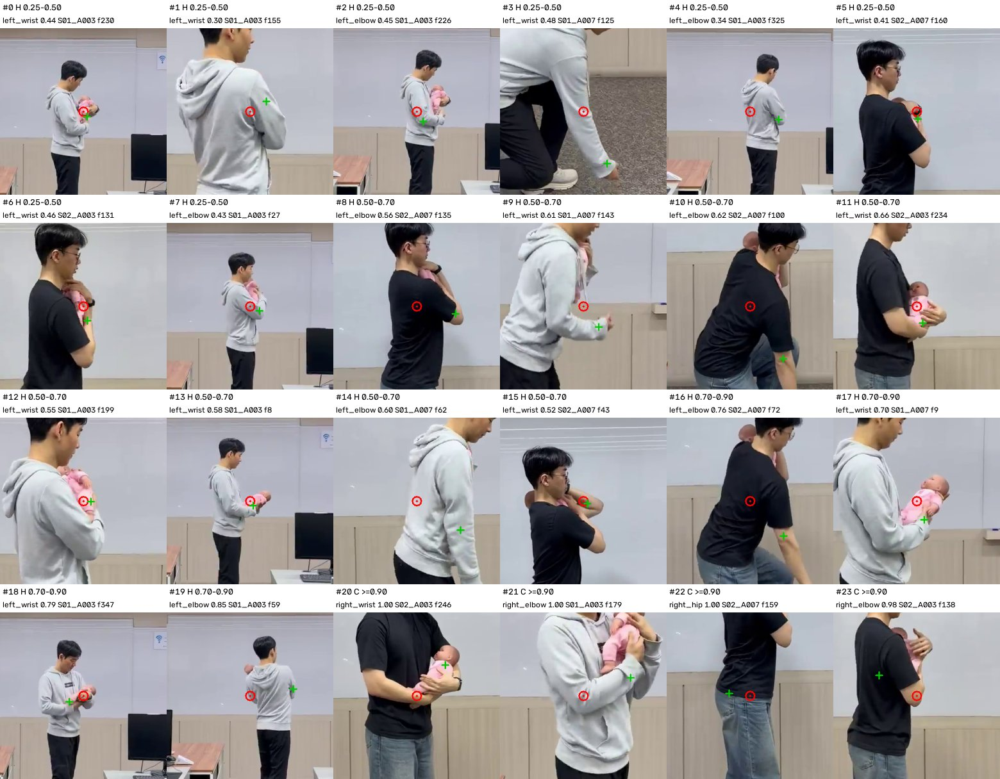

# 관절 신뢰도 기준값(threshold) 분석 보고서 (2판)

- 작성일: 2026-11-18
- 대상: `sub10_project/reports/day02/tables/`의 10번 결과 27개 영상 (S01 18개, S02 6개, S03 3개)
- 상태: **잠정안**이다. 팀 합의 전이며, 육안 판정은 한 명(Claude)이 했다.
- 2판에서 바뀐 점
  - 교재 2일차의 결과 기록 양식(§17 비교표, §18 해석 순서, §19 한 조건 비교, §24 Frame 확인, §32 실험 기록)을 뼈대로 다시 썼다.
  - "사람 검출과 관절 품질은 따로 본다"(§18.1) 관점의 분석을 추가했다. 배우가 아닌 대상의 관절이 높은 신뢰도로 잡힌 경우(A007 등)와, 배우의 관절인데 신뢰도가 높으면서 자리가 틀린 경우(A008)를 다룬다.

### 교재 양식과 이 보고서의 대응

| 교재 2일차 | 이 보고서 |
|---|---|
| §32 팀 실험 기록 (실험 → 결과 → 해석) | 0장 |
| §17 비교표 (사람 수, BBox, 평균 KP Conf, LOW 관절 수, 가장 낮은 관절·Conf) | 3장 |
| §18.1 사람 검출과 관절 품질은 따로 본다 | 4.1 |
| §18.2 결과를 세 그룹으로 나눈다 | 4.2 |
| §23~24 가장 불안정한 Frame을 찾아 실제 영상을 확인한다 | 4.3 |
| §19 한 조건만 골라 비교한다 (조건 변화를 먼저 확인하고, X/O로 해석) | 5장 |
| §14~15 기준값을 바꿔 보고, 실험값과 비교 기준을 구분한다 | 6장 |
| §18.4·§18.6 목적별 처리, 결과의 활용 | 8장 |

---

## 0. 실험 기록 (2일차 §32 양식)

### 1. 실험

- **선택한 조건**: 방향(정면·왼쪽·오른쪽), 거리(근·원), 사람(S01·S02·S03)
- **바꾼 조건 한 가지**: 한 번의 비교에서는 하나만 바꿨다(5장).
  - 방향: S01 근거리에서 정면 ↔ 옆
  - 거리: S01 같은 방향에서 근 ↔ 원
  - 사람: 근거리 정면과 근거리 오른쪽에서 S01 ↔ S02(↔ S03)
- **고정한 것**: 같은 모델(yolo11n-pose), 사람 검출 기준 0.25, LOW 기준 0.50(비교용), 같은 방, 같은 동작 3개(A003·A007·A008)

### 2. 결과

| 조건 | 평균 KP Conf | Frame당 LOW 관절 수 (평균 / 최대) | 가장 자주 낮은 관절 | 가장 낮은 Conf |
|---|---|---|---|---|
| 정면 (근·원, 3명) | 0.938~0.961 | 0.19~0.45 / 1~5 | 귀 | 0.005 |
| 옆모습 (근·원, 2명) | 0.802~0.857 | 2.04~2.91 / 4~6 | 카메라 반대쪽 귀 | 0.002 |

- **가장 불안정했던 Frame**: S01_A003_far_right 262번(10.875초), LOW 6개. 몸을 돌려 얼굴과 왼팔이 가려진 순간이다.
- **신뢰도와 별개로 배우의 관절이 아니었던 경우**:
  - S01_A007_far_left: 천장 쪽 물체를 사람으로 검출했다(26 Frame).
  - A008 옆모습 3개 영상: 인형을 사람으로 검출했다.
  - S03_A008_near_front: 신뢰도 0.99인 어깨·골반이 인형 쪽으로 몰리거나 좌우가 뒤집혔다.

### 3. 해석

- **어떤 조건에서 불안정했나**: 이번 데이터에서는 옆모습이 가장 불안정했다. 낮아진 관절은 대부분 카메라 반대쪽 얼굴과 반대쪽 팔꿈치·손목이었다. 다리·골반·카메라 쪽 팔은 정면 수준이었다.
- **실제 영상에서 본 이유**: 몸에 가려지거나, 몸을 돌리거나, 인형이 얼굴을 가린 순간에 낮아졌다.
- **낮은 관절을 쓸 때의 주의**: 낮은 신뢰도는 "가려져서 짐작했다"에 가까웠다(6.4). 반대로 높은 신뢰도도 "배우의 관절"을 보장하지 않았다(4.1). 따라서 기준값은 관절 하나의 위치를 믿을지 정하는 데만 쓰고, 그 골격이 배우의 것인지와 모양이 맞는지는 별도 검사로 확인해야 한다.

---

## 1. 무엇을 정하려는가

기준값(threshold)은 관절 신뢰도를 보고 그 관절 좌표를 쓸지 가르는 경계값이다. 기준값 이상이면 쓰고, 미만이면 LOW 관절로 센다(2일차 §14).

교재는 0.50을 "여러 촬영 조건을 같은 기준으로 비교하기 위한 교육용 기준값"으로 두고, 모든 프로젝트의 정답은 아니라고 밝힌다(2일차 §15). 이 프로젝트는 아기 인형을 안고 하는 동작이고, 촬영 방향과 거리도 교재와 다르다. 그래서 프로젝트 데이터로 다시 확인한다.

| 기준값이 쓰이는 곳 | 쓰임 | 근거 |
|---|---|---|
| 10번 `--kp-conf` (0.50) | Frame별 LOW 관절 수를 센다. 관절 CSV의 원래 신뢰도에는 영향이 없다 | `scripts/10_pose_video_quality.py` |
| 27번 자동 검수 | 중요 관절 중 기준 미만 비율이 0.20을 넘으면 CHECK로 분류한다 | `scripts/27_keypoint_qa.py` 449~458행 |
| 6일차 Sequence 생성(예정) | 교재 코드는 관절별 신뢰도로 좌표를 거르지 않는다 | 6일차 교재 `sequence_utils.py` (아직 프로젝트에 없다) |

## 2. 데이터

| 사람 | 정면 | 왼쪽 | 오른쪽 | 거리 | 동작 |
|---|---|---|---|---|---|
| S01 | ○ | ○ | ○ | 근·원 | A003, A007, A008 |
| S02 | ○ | – | ○ | 근 | A003, A007, A008 |
| S03 | ○ | – | – | 근 | A003, A007, A008 |

- **동작**: A003 walk_soothe(안고 달래기), A007 hold_pick_object(안은 채 바닥까지 앉았다 일어나기), A008 shake(몸 앞에 세워 들고 흔들기).
- **"왼쪽·오른쪽"의 뜻**: 카메라가 사람의 왼쪽·오른쪽 몸을 보고 찍었다는 뜻이다. 옆모습 영상마다 해당 쪽 몸 관절의 신뢰도가 반대쪽보다 높아 데이터로 확인했다.
- **제외한 데이터**: S01의 방향 구분 없는 연속 영상 6개는 제외했다.
- **실행 환경**: S01은 사용자의 WSL GPU 환경, S02·S03은 Claude 작업 공간의 CPU 환경에서 10번을 실행했다. 같은 영상으로 두 환경의 결과를 비교하면 신뢰도 차이는 최대 0.0013이었다.

---

## 3. 비교표 (2일차 §17 형식)

| 방향 | 거리 | 사람 | Frame | 사람 1명 비율 | 2명 이상 Frame | 관절 범위 면적 비율* | 평균 KP Conf | LOW 관절 수 (평균 / 최대) | 가장 자주 낮은 관절 | 가장 낮은 Conf |
|---|---|---|---|---|---|---|---|---|---|---|
| 정면 | 원 | S01 | 853 | 1.000 | 0 | 0.028 | 0.938 | 0.28 / 2 | left_ear | 0.068 |
| 정면 | 근 | S01 | 807 | 1.000 | 0 | 0.143 | 0.948 | 0.45 / 5 | left_ear | 0.005 |
| 정면 | 근 | S02 | 649 | 1.000 | 0 | 0.130 | 0.961 | 0.19 / 1 | right_ear | 0.064 |
| 정면 | 근 | S03 | 580 | 1.000 | 0 | 0.177 | 0.947 | 0.30 / 4 | right_ear | 0.051 |
| 왼쪽 | 원 | S01 | 886 | 0.941 | 26 | 0.028 | 0.825 | 2.53 / 4 | right_ear | 0.060 |
| 왼쪽 | 근 | S01 | 829 | 0.981 | 13 | 0.138 | 0.857 | 2.04 / 6 | right_ear | 0.002 |
| 오른쪽 | 원 | S01 | 821 | 1.000 | 0 | 0.029 | 0.802 | 2.91 / 6 | left_ear | 0.018 |
| 오른쪽 | 근 | S01 | 816 | 0.969 | 18 | 0.150 | 0.826 | 2.31 / 5 | left_ear | 0.007 |
| 오른쪽 | 근 | S02 | 581 | 0.949 | 22 | 0.114 | 0.811 | 2.62 / 5 | left_ear | 0.012 |

- 각 칸은 동작 3개 영상의 평균이다. 단 2명 이상 Frame은 합계, 최대와 가장 낮은 Conf는 최댓값·최솟값이다.
- LOW 관절 수는 10번이 Frame마다 센 `low_keypoint_count`(17개 관절 중 0.50 미만)다.
- \* 교재의 BBox Area Ratio는 10번 CSV에 기록되지 않는다. 그래서 Frame마다 관절 17개를 감싸는 사각형의 넓이를 화면 넓이로 나눈 값(중앙값)으로 대신했다. 사람이 화면에서 얼마나 크게 보이는지를 나타낸다.
- 영상별 표는 `out/textbook_format_by_video.csv`에 있다.

---

## 4. 비교표 해석 (2일차 §18 순서)

교재의 순서대로 사람 검출 → 평균 KP Conf → LOW 관절 수 → 가장 낮은 관절 → 실제 영상 확인 순으로 읽는다.

### 4.1 사람 검출과 관절 품질은 따로 본다 (§18.1)

교재는 "사람을 잘 찾았다 ≠ 모든 관절도 잘 찾았다"라고 한다. 이번 데이터에서는 그 반대 방향도 확인됐다. **관절 신뢰도가 높다고 해서 그 관절이 배우의 것이라는 보장은 없다.** 두 가지 경우가 있었다.

#### ① 배우가 아닌 대상이 사람으로 검출되고, 그 관절도 신뢰도를 받았다

2명 이상 잡힌 영상 4개를 같은 모델과 같은 사람 검출 기준(0.25)으로 다시 검출했다. 두 번째 검출 대상의 정체와 신뢰도는 다음과 같았다(`out/secondary_detections.csv`, `spot/multi_person_check.jpg`).

| 영상 | Frame | 두 번째 검출 대상 | 사람 BBox 신뢰도 (평균) | 몸 관절 12개 평균 신뢰도 | 0.50 이상 관절 수 (평균 / 최대, 17개 중) |
|---|---|---|---|---|---|
| S01_A007_far_left | 26 | 화면 맨 위 천장 쪽 물체 | 0.34 | 0.58 | 8.4 / 10 |
| S01_A008_near_left | 13 | 아기 인형 | 0.43 | 0.48 | 9.1 / 12 |
| S01_A008_near_right | 18 | 아기 인형 | 0.47 | 0.58 | 10.2 / 15 |
| S02_A008_near_right | 22 | 아기 인형 | 0.36 | 0.58 | 9.8 / 13 |

- **무엇을 뜻하나**: A007 원거리 영상에서 모델은 천장 쪽 물체에도 다리까지 그린 골격을 만들었다. 그 관절의 평균 신뢰도는 0.58이었고, 17개 중 평균 8개 이상이 0.50을 넘었다. 인형도 마찬가지였다. 기준값 0.50은 이런 관절의 절반가량을 "믿을 만한 관절"로 통과시킨다.
- **왜 그런가**: 관절 신뢰도는 "이것이 사람이라면 그 관절 위치를 얼마나 확신하는가"에 대한 값이다. "이것이 배우인가"에 대한 값이 아니다. 배우인지 가르는 일은 사람 BBox 단계의 몫이다.
- **현재 결과 CSV는 괜찮은가**: 괜찮았다. 10번은 BBox 신뢰도가 가장 높은 1명만 기록하는데, 배우의 BBox는 평균 0.88~0.92(최소 0.865)로 두 번째 대상(평균 0.34~0.47)보다 늘 높았다. 실제로 27개 영상 모두에서 기록된 골격의 중심이 영상 내내 배우 위치에서 벗어나지 않았다(앞뒤 9 Frame 중앙값에서 100픽셀 넘게 벗어난 Frame 0개).
- **어디서 위험해지나**:
  - 배우가 크게 가려지거나 멀어져 배우 BBox 신뢰도가 떨어지면, 두 번째 대상이 선택될 수 있다.
  - 7일차(실시간)와 8일차(여러 사람 추적)처럼 매 Frame 사람을 새로 고르는 단계에서도 그렇다.
  - 27번의 한 사람 비율 검사(0.90 미만이면 CHECK)는 S01_A007_far_left(0.822)와 S02_A008_near_right(0.848)는 잡는다. 하지만 S01_A008_near_left(0.943)와 near_right(0.908)는 통과시킨다.

#### ② 배우의 골격인데, 신뢰도가 높으면서 자리가 틀렸다

S03_A008_near_front(정면, 인형을 얼굴 앞에 세워 드는 순간)에서 어깨·골반의 신뢰도가 0.99인데도 골격 모양이 무너졌다(`spot/s03_a008_collapse.jpg`).

- **확인한 것**:
  - 어깨 두 점이 실제 어깨가 아니라 인형을 든 손 근처로 좁게 몰렸다.
  - 골반 폭은 영상 중앙값 118픽셀에서 최소 6픽셀까지 줄었다.
  - 5개 Frame(37, 59, 102, 126, 127번)에서는 어깨의 좌우가 뒤집혔고, 그중 37번을 뺀 4개는 골반도 뒤집혔다. 카메라를 보는 사람의 왼쪽은 화면 오른쪽에 있어야 하는데 반대로 찍혔다.
- **범위**: 같은 검사(정면, 양쪽 신뢰도 0.80 이상)를 정면 영상 12개 전부에 돌렸다. 좌우가 뒤집힌 경우는 이 영상에서만 나왔다. 어깨 폭이 영상 상위 10% 값의 60% 아래로 줄어든 Frame은 이 영상(8개, 5%), S01_A003 원거리·근거리 정면(8개·37개), S02_A003 근거리 정면(1개)에서만 나왔다. A003은 몸을 돌리며 달래는 동작이라, 실제로 몸이 돌아가 어깨 폭이 좁아진 경우가 섞여 있을 수 있다(확인하지 않았다).
- **왜 그런가 (추정)**: 얼굴이 인형에 완전히 가려지면 모델이 사람이 카메라를 보는지 등지는지를 가를 단서를 잃는다. 그 결과 좌우를 바꾸거나, 인형의 팔·손을 어깨로 착각한 것으로 보인다. 관절 하나하나는 "관절처럼 생긴 것" 위에 있으니 신뢰도는 높게 유지된다.
- **무엇을 뜻하나**: 기준값으로는 이 경우를 걸러낼 수 없다. 어깨 폭, 좌우 순서 같은 골격 모양 검사가 따로 필요하다.

### 4.2 결과를 세 그룹으로 나누면 (§18.2)

| 그룹 | 해당 | 근거 |
|---|---|---|
| 전체적으로 안정적 | 정면 영상 대부분 | 평균 KP Conf 0.938~0.961, Frame당 LOW 0.19~0.45개. LOW는 거의 귀 |
| 일부 순간 주의 | 정면 A008: S01_A008_near_front(LOW 최대 5), S03_A008_near_front(LOW 최대 4, 4.1②) | 인형을 얼굴 앞에 드는 순간에 얼굴 관절이 몰려서 낮아졌다 |
| 품질 저하가 크게 나타남 | 옆모습 영상 전부 | 평균 KP Conf 0.802~0.857, Frame당 LOW 2.04~2.91개 |

이번 데이터에서는 옆모습이 가장 불안정했다. 교재 §18.2의 경고대로 "옆모습이면 항상 나쁘다"로 일반화하지 않는다. 다음 절과 5장에서 무엇이 왜 낮아졌는지 확인한다.

### 4.3 가장 불안정한 Frame과 실제 영상 확인 (§23~24)

교재처럼 Frame을 "LOW 관절 수가 많은 순 → 평균 신뢰도가 낮은 순"으로 정렬해 영상마다 가장 불안정한 Frame을 골랐다(`out/worst_frame_by_video.csv`). 그중 LOW가 가장 많은 Frame들을 Pose 영상에서 직접 확인했다.



| 영상 | Frame (시간) | LOW 관절 | 실제 영상에서 본 것 |
|---|---|---|---|
| S01_A003_far_right | 262 (10.875초) | 6개: 코, 양 눈, 왼귀, 왼팔꿈치, 왼손목 | 몸을 돌려 등이 카메라 쪽으로 향했다. 얼굴과 왼팔이 가려졌다 |
| S01_A003_near_left | 100 (4.125초) | 6개: 코, 양 눈, 오른귀, 오른팔꿈치, 오른손목 | 몸이 돌아가 얼굴이 카메라 반대를 향했다. 오른팔이 몸 뒤로 가려졌다 |
| S01_A008_near_front | 34 (1.375초) | 5개: 코, 양 눈, 양 귀 | 인형을 얼굴 앞으로 들어 올려 얼굴을 가렸다 |
| S03_A008_near_front | 127 (5.25초) | 4개: 코, 양 눈, 왼귀 | 인형이 얼굴을 가렸다. 같은 Frame에서 어깨·골반이 0.99로 잘못 몰렸다(4.1②) |
| (참고) S01_A007_far_left | 104 | 1개: 오른귀 | 배우의 골격은 정상이다. 그런데 화면 맨 위 물체에 두 번째 골격이 그려졌다(4.1①) |

교재 §24.2처럼 "LOW가 많다 = Pose 실패"로 단정하지 않는다. 위 Frame들에서 낮아진 관절은 실제로 보이지 않는 부위였다. 오히려 신뢰도로 드러나지 않은 문제(4.1)가 실제 영상 확인에서 발견됐다.

---

## 5. 한 조건씩 비교 (2일차 §19 형식)

교재 §19처럼, 먼저 바꾼 조건이 데이터에 실제로 나타났는지 확인하고, 그다음 품질이 변했는지 본다.

### 5.1 방향 (S01 근거리: 정면 ↔ 옆)

- **조건 변화가 데이터에 나타났나**: 그렇다. 옆모습에서 카메라 쪽 몸 관절은 0.987~0.994, 반대쪽은 0.860~0.901이었다(S01 근거리, `out/summary_by_condition.csv`).
- **품질 변화**: 평균 KP Conf는 0.948에서 0.826~0.857로 내려갔다. Frame당 LOW는 0.45개에서 2.04~2.31개로 늘었다.
- **어디가 낮아졌나**: 반대쪽 얼굴(귀·눈)과 반대쪽 팔꿈치·손목이다. 반대쪽 팔꿈치·손목의 중앙값은 0.62~0.64였다. 반대쪽이라도 어깨·골반·무릎·발목은 0.946~0.993이었다(`out/hidden_side_median_by_joint.csv`).

> X 옆모습에서는 관절 전체가 불안정하다.
> O 이번 데이터에서 옆모습은 카메라 반대쪽 얼굴과 반대쪽 팔꿈치·손목의 신뢰도를 낮췄고, 다리·골반·카메라 쪽 팔은 정면과 비슷했다.

### 5.2 거리 (S01, 같은 방향에서 근 ↔ 원)

- **조건 변화가 데이터에 나타났나**: 그렇다. 관절 범위 면적 비율이 근거리 0.138~0.150에서 원거리 0.028~0.029로, 약 5분의 1이 됐다.
- **품질 변화**:

| 방향 | 평균 KP Conf (근 → 원) | Frame당 LOW (근 → 원) |
|---|---|---|
| 정면 | 0.948 → 0.938 | 0.45 → 0.28 |
| 왼쪽 | 0.857 → 0.825 | 2.04 → 2.53 |
| 오른쪽 | 0.826 → 0.802 | 2.31 → 2.91 |

> X 사람이 멀어지면 Pose 품질은 떨어진다.
> O 이번 데이터에서 정면은 사람이 5분의 1 크기로 작아져도 품질이 유지됐다(교재 §19의 front / distance_far 결과와 같다). 옆모습에서만 원거리일 때 조금 더 낮아졌다. 거리 자체보다 "작게 찍힘"과 "가려짐"이 겹칠 때 낮아졌다.

### 5.3 사람 (근거리 정면: S01·S02·S03 / 근거리 오른쪽: S01 ↔ S02)

- **조건 변화가 데이터에 나타났나**: 사람만 바뀐 게 아니었다. 근거리 오른쪽에서 관절 범위 면적 비율이 S01 0.150, S02 0.114로 화면 속 크기도 달랐다. 서 있던 거리 또는 키 차이 때문이다.
- **품질 변화**:
  - 정면: 평균 KP Conf 0.948 / 0.961 / 0.947. 세 사람의 차이는 0.014 이내였다.
  - 오른쪽: 0.826 / 0.811, Frame당 LOW 2.31 / 2.62.

> X S02는 Pose가 잘 나오지 않는 사람이다.
> O 이번 데이터에서 정면은 세 사람이 거의 같았다. 옆모습에서는 S02가 조금 낮았지만, 화면 속 크기도 달라서 사람 차이 때문이라고 가를 수 없다.

### 5.4 동작

- 정면 A003·A007은 세 사람 모두 LOW 최대 1~2개로 안정적이었다.
- 정면 A008은 인형을 얼굴 앞에 드는 순간에 얼굴 관절이 낮아졌고, 골격 모양이 무너지기도 했다(4.1②).
- A007은 정면 영상에서 좌우 뒤집힘이나 어깨 폭 붕괴가 한 번도 없었다. A007에서 확인된 문제는 원거리 왼쪽 영상의 배경 물체 검출(4.1①)이다.

> X A008은 Pose가 잘 안 되는 동작이다.
> O 이번 데이터에서 A008은 인형이 얼굴을 가리는 자세가 있어서, 관절 신뢰도가 높아도 골격 모양이 틀어지는 순간이 생겼다.

---

## 6. 기준값 구간별 비교 (2일차 §14~15의 확장)

### 6.1 분석에 쓴 가정

- **중요 관절(임시)**: A003·A007은 몸 관절 12개, A008은 어깨·팔꿈치·손목·골반 8개로 정했다. 팀이 27번에 넣을 값을 정하기 전의 가정이다.
- **27번 모의의 근사**: 27번은 26번 결과의 사람 수를 읽는다. 여기서는 10번의 `people` 열로 대신했다.

### 6.2 27번 자동 검수에 주는 영향

| 기준값 | CHECK 영상 수 | 그중 낮은 신뢰도 때문 | 낮은 신뢰도로 걸린 영상 |
|---|---|---|---|
| 0.25 / 0.50 | 2 | 0 | – |
| 0.70 | 2 | 1 | S02_A008_near_right (이미 사람 2명 Frame 때문에 CHECK) |
| 0.80 | 5 | 4 | A008 옆모습 4개 |
| 0.90 | 9 | 9 | 원거리 옆모습 6개, A008 근거리 옆모습 3개 |
| 0.95 | 14 | 14 | 옆모습 대부분, 정면 원거리 A008 1개 |

기준값을 0.25~0.50으로 해도 CHECK가 2개 나왔다. 둘 다 사람이 2명 잡힌 영상(4.1①의 천장 물체와 인형)이며, 기준값과는 관계없다.

### 6.3 옆모습에서 보이는 팔과 가려진 팔을 얼마나 가르나

| 기준값 | 0.25 | 0.30 | 0.40 | **0.50** | 0.60 | 0.70 | **0.80** | 0.90 | 0.95 |
|---|---|---|---|---|---|---|---|---|---|
| 카메라 쪽 팔: 남는 비율 | 100% | 100% | 100% | 100% | 99.9% | 99.6% | 98.8% | 95.8% | 88.6% |
| 가려진 팔: 걸러지는 비율 | 0.9% | 2.6% | 10.8% | 28.8% | 43.9% | 66.7% | 85.9% | 94.3% | 97.0% |





### 6.4 Frame 단위로 거를 때 남는 양

중요 관절이 **모두** 기준값 이상인 Frame의 비율이다.

| 조건 | 0.30 | 0.50 | 0.70 | 0.80 | 0.90 |
|---|---|---|---|---|---|
| 정면 근거리 | 100% | 100% | 99.6% | 97.3% | 89.7% |
| 정면 원거리 | 100% | 100% | 100% | 99.3% | 86.0% |
| 왼쪽 근거리 | 100% | 89.3% | 62.0% | 19.3% | 9.7% |
| 왼쪽 원거리 | 100% | 57.2% | 14.2% | 3.3% | 0.4% |
| 오른쪽 근거리 | 95.5% | 67.0% | 18.0% | 9.1% | 6.3% |
| 오른쪽 원거리 | 88.5% | 54.4% | 14.0% | 2.8% | 0.0% |

### 6.5 신뢰도가 낮으면 좌표가 튀는가

| 신뢰도 구간 | 관절 수 | 흔들림 중앙값 | 몸통 길이의 10% 넘게 튄 비율 |
|---|---|---|---|
| 0.25~0.50 | 2,158 | 0.004 | 0.4% |
| 0.50~0.70 | 3,062 | 0.007 | 0.4% |
| 0.70~0.90 | 4,257 | 0.007 | 1.0% |
| 0.90~1.00 | 71,020 | 0.003 | 0.2% |

- 흔들림은 앞뒤 2 Frame과의 시간 중앙값에서 떨어진 거리를 몸통 길이로 나눈 값이다. 정답 없이 볼 수 있는 대리 지표다.
- 0~0.25 구간은 관절이 71개뿐이라 뺐다.
- 신뢰도가 낮은 구간에서도 좌표가 크게 튀지 않았다.

### 6.6 육안 판정

옆모습 영상 5개에서 신뢰도 구간별로 표본을 뽑아 원본 Frame 위에 표시해 판정했다. 빨간 원이 판정 대상 관절이고, 초록 십자는 같은 이름의 반대쪽 관절이다.



| 구간 | 표본 | 맞음 | 그럴듯함 | 의심 | 틀림 |
|---|---|---|---|---|---|
| 가려진 쪽 0.25~0.50 | 8 | – | 6 | 1 | 1 |
| 가려진 쪽 0.50~0.70 | 8 | – | 7 | 1 | – |
| 가려진 쪽 0.70~0.90 | 4 | – | 4 | – | – |
| 카메라 쪽 0.90 이상 | 4 | 4 | – | – | – |

- **판정 기준**: "그럴듯함"은 가려져서 확인할 수 없지만 그 팔이 있을 법한 자리에 찍힌 경우다.
- **틀림 1개 (#3, 0.48)**: 가려진 왼손목이 바닥으로 뻗은 오른팔 위에 찍혔다.
- **주의**: 이 표본은 모두 배우의 골격에서 뽑았다. 4.1의 문제(배우가 아닌 골격, 신뢰도 높은 붕괴)는 이 판정 방식에 잡히지 않는다.

---

## 7. 원인 해석

1. **옆모습의 낮은 신뢰도는 가려짐 때문이다.** 카메라 반대쪽 팔은 몸통과 인형에 가려지고, 모델은 보이지 않는 관절에 낮은 신뢰도로 짐작한 좌표를 준다. 다리와 골반은 서 있는 자세에서 화면에 따로 보이므로 높게 나온 것으로 보인다.
2. **귀가 가장 자주 낮다.** 정면에서도 그렇다. 2일차 교재의 `front.jpg`에서도 가장 낮은 관절이 `right_ear`(0.7428)였다(§17). 귀는 머리카락과 얼굴 각도에 쉽게 가려지는 작은 부위다. 동작 판별에 쓰지 않으면 기준값 결정에서 빼도 된다(§18.4의 "목적에 따라 중요한 관절이 다르다").
3. **몸을 돌리거나 인형이 얼굴을 가리는 순간에 LOW가 몰린다(4.3).** 이것은 촬영 조건(방향)이 아니라 동작 안의 순간이 만든 저하다.
4. **원거리에서는 가려짐과 겹칠 때만 더 낮아졌다(5.2).**
5. **사람 간 차이는 이 데이터로 원인을 가를 수 없다(5.3).** 화면 속 크기, 옷 색, 팔 위치가 함께 달랐다.
6. **높은 신뢰도가 틀린 경우는 "무엇의 관절인가"를 모델이 잘못 판단했을 때 생겼다(4.1).** 배경 물체나 인형을 사람으로 봤거나, 얼굴이 가려져 몸의 방향을 잘못 읽은 경우다. 관절 신뢰도는 "이 점이 관절처럼 생겼는가"에 답할 뿐, "이 골격이 배우의 것이고 앞을 보고 있는가"에는 답하지 않는다.

---

## 8. 의미와 활용 (2일차 §18.4·§18.6)

### 8.1 목적별로 다르게 처리한다

| 목적 | 낮은 신뢰도가 나오면 | 높은 신뢰도인데 틀릴 수 있는 경우 |
|---|---|---|
| 데이터 검수(27번) | 기준값 **0.50 유지**. 0.25~0.50에서 결과가 같았고, 0.80부터는 옆모습 영상이 대부분 CHECK가 되어 검수 부담만 늘어난다 | 한 사람 비율 검사가 일부만 잡는다(4.1①). 골격 모양 검사(어깨 폭, 좌우 순서)를 추가하는 것을 검토한다 |
| 관절각도·Feature 계산 | 가려진 팔을 거르려면 **0.80 근처**가 맞는다(6.3). 0.50에서는 가려진 팔의 71%가 통과한다 | 기준값으로는 거를 수 없다(4.1②). 골격 모양 검사에 걸린 Frame은 계산에서 빼거나 표시한다 |
| 실시간 판별(7·8일차) | 위와 같다 | 매 Frame 사람을 새로 고르므로 배우가 아닌 대상이 선택될 위험이 커진다. 추적 번호를 유지하거나, 사람 BBox 크기와 위치로 걸러야 한다 |

### 8.2 촬영 조건을 조정할 수 있다면 (§18.6 ①)

- **옆모습**: 완전한 측면 대신 정면 쪽으로 조금 돌려 찍으면 반대쪽 팔이 덜 가려질 수 있다. 다만 프로젝트가 옆모습 판별을 해야 한다면, 촬영을 피하지 말고 8.3처럼 처리한다(§18.5).
- **원거리**: 화면 위쪽에 사람처럼 보이는 배경 물체가 들어오지 않게 구도를 잡는다.
- **A008**: 인형이 얼굴을 완전히 가리는 순간이 생기지 않게 촬영 각도를 잡을 수 있는지 팀과 확인한다.

### 8.3 옆모습을 반드시 써야 한다면 (§18.6 ②)

0.80 기준을 "중요 관절이 모두 기준 이상인 Frame만 쓰기"와 함께 쓰면 옆모습 근거리 Frame이 9~19%만 남는다(6.4). 그래서 둘 중 하나가 필요하다.

1. 기준 미만 관절만 관절 단위로 빈 값으로 두고 나머지로 계산한다.
2. 옆모습에서는 카메라 쪽 팔과 양쪽 다리를 중요 관절로 삼는다.

교재 6일차 코드는 관절별 신뢰도를 보지 않으므로, 어느 쪽이든 Sequence 생성 단계에 넣어야 한다.

### 8.4 정하지 않고 남긴 것

- 27번 `ACTION_CRITICAL_KEYPOINTS`에 넣을 동작별 중요 관절
- 배경 물체·인형 검출을 사람 검출 기준(0.25) 조정, 한 사람 비율 기준, BBox 크기 조건 중 무엇으로 막을지
- 골격 모양 검사의 구체적인 기준(예: 어깨 폭이 영상 기준값의 몇 % 아래면 표시)
- Feature용 기준을 0.80으로 할지 0.70·0.85로 할지. 판정 표본이 적어 0.05 단위로 가를 근거가 아직 없다.

---

## 9. 한계

- 육안 판정은 한 명이 24개 표본과 몇 개의 Frame으로만 했다.
- 왼쪽 방향과 원거리는 S01만 있다.
- S01과 S02·S03의 실행 환경이 다르다(차이는 신뢰도 0.0013 이하로 확인).
- 관절 범위 면적 비율은 BBox Area Ratio의 대체값이다.
- 27번 모의는 26번 대신 10번 결과로 했다.
- 4.1②의 골격 모양 검사(좌우 순서, 어깨 폭)는 정면 영상에만 적용했다. 옆모습에서는 좌우 관절이 원래 겹쳐 보이므로 같은 방식을 쓸 수 없다.

## 10. 다음 확인

1. 2~3명이 같은 표본을 따로 판정해 일치율을 본다. 0.70~0.90 구간 표본을 늘린다.
2. S02·S03의 왼쪽·원거리 영상을 추가한다.
3. 팀이 중요 관절을 정한 뒤 분석을 다시 돌린다.
4. 골격 모양 검사를 27번 보조 규칙으로 넣어 볼지 정하고, 걸리는 Frame을 Pose 영상에서 확인한다.
5. 검수 0.50, Feature 0.80(관절 단위 가리기)으로 6일차 Baseline을 만들고, 가리지 않은 경우와 검증 성능을 비교한다. 한 번에 한 조건만 바꾼다.

## 11. 재현 방법과 파일

```bash
# sub10_project 루트에서
python experiments/threshold/analyze_threshold.py --tables reports/day02/tables --out experiments/threshold/out
python experiments/threshold/make_figs.py reports/day02/tables experiments/threshold/out
python experiments/threshold/check_secondary_detections.py --out experiments/threshold/out/secondary_detections.csv <2명 이상 잡힌 원본 영상들>
```

| 파일 | 내용 |
|---|---|
| `out/textbook_format_by_video.csv`, `out/textbook_format_by_condition.csv` | 3장 비교표 |
| `out/worst_frame_by_video.csv`, `spot/worst_frames.jpg` | 4.3 |
| `out/secondary_detections.csv`, `spot/multi_person_check.jpg` | 4.1 ① |
| `out/front_left_right_flips.csv`, `out/skeleton_shape_checks.csv`, `spot/s03_a008_collapse.jpg` | 4.1 ② (기록된 골격이 튀었는지는 `track_jump_frames_gt100px` 열) |
| `out/summary_by_condition.csv`, `out/hidden_side_median_by_joint.csv`, `out/hidden_arm_median_by_group.csv` | 5장 |
| `out/threshold_sweep_by_video.csv`, `out/threshold_sweep_by_condition.csv`, `out/visibility_separation.csv`, `out/jitter_*.csv` | 6장 |
| `spot/spot_samples.csv`, `spot/spot_judgments.csv`, `spot/spot_sheet.jpg` | 6.6 (`spot_sample.py`의 영상 경로는 실행 환경에 맞게 고쳐야 한다) |

## 더 읽기

- 교재 2일차 §14·15(Threshold), §17·18(비교표와 해석, 특히 18.1·18.4·18.6), §19(거리 조건 비교), §23·24(Frame 확인), §32(실험 기록)
- 교재 5일차 §15(Pose Missing과 Low Confidence), §16(동작별 중요 관절)
- `scripts/27_keypoint_qa.py` 판정 규칙(449~458행)
